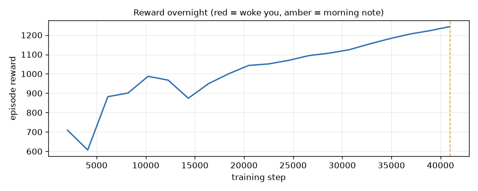
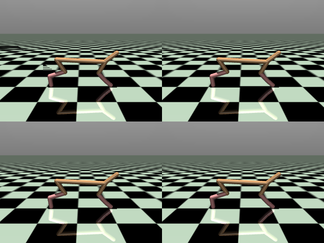
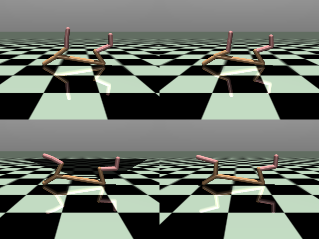
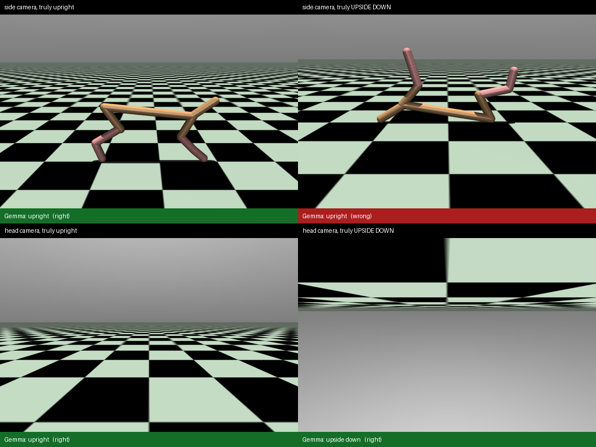

# Night Watch

[](https://github.com/su0as/night-watch/actions/workflows/ci.yml)

**Sleep while your robot learns.** Two open models watch an overnight reinforcement-learning run, and you only get woken when it is worth it.

- **TabPFN** reads the training metrics and compares them with past runs that broke.
- **Gemma 4**, running locally through Ollama, looks through a camera bolted to the robot's head.
- A few plain rules catch NaNs, stalls and crashes.
- A **Temporal** workflow keeps the watch going even if the watcher process dies at 3 a.m.

In the morning you get a one-page report: a time-lapse of the night, the reward curve, and what (if anything) went wrong.

> Built for the DEV x Hacktoberfest 2026 Open-Source AI Challenge, Week 3: *Slow and Steady*. The repository was started and completed during the challenge window (19 to 25 October 2026).

### The failure this is built for

This is a real 40k-step smoke run from CI. The reward has a sign bug in a "keep the torso level" term. The reward curve climbs the whole time, from 709 to 1244, and no alert threshold fires:



Meanwhile, the robot at the start (the reference picture Gemma gets) and at step 40,000:

| step 0 (reference) | step 40,000 |
|---|---|
|  |  |

The simulator agrees: the torso was upside down for 92% of that test episode. The threshold watcher's morning report for this run says "Nothing worth waking you for".

<!-- TODO before publishing: replace with a time-lapse from a real night (runs/<name>/report/timelapse.gif) -->

## Why

Training a robot policy in simulation takes hours, so you start it before bed. Then you wake up at 2 a.m. to check it, because:

- **the run can die quietly** (a hung data loader, a crash, a NaN), which wastes the whole night;
- **the run can go wrong while looking great.** If the reward has a bug, the robot finds it. The reward curve climbs all night while the robot learns to lie on its back and wiggle. Alert thresholds on the reward never fire, because the reward is going *up*.

You only see that second kind by looking at the robot. Night Watch looks for you.

### Gemma could not see it from the side, so the robot got a head camera

The first version showed Gemma 4 E4B the usual side view. A controlled test (`python -m nightwatch eyetest`: drop the robot into a known pose, let the physics settle it, ask the same judge that runs at night) showed it called **every** robot "upright", including the ones lying on their backs. Bigger pictures, other wordings, a reference picture and thinking mode did not fix it. A camera fixed to the robot's body did: when the robot flips, its camera flips too, and "where are the floor and the sky in this picture?" is a question Gemma gets right. On its back, the sky is at the bottom of the picture, which never happens the right way up.



| what Gemma is shown | right calls | upside-down robots caught | seconds per test episode (laptop iGPU) |
|---|---|---|---|
| side camera, 2x2 sheet of 320x240 snapshots (first version) | 6 / 12 | 0 / 6 | 10 |
| side camera, full-size 1024x768 snapshots | 6 / 12 | 0 / 6 | 19 |
| **head camera, 4 snapshots at 512x384** | **12 / 12** | **6 / 6** | 19 |

Full table: [docs/EYETEST.md](docs/EYETEST.md).

## How it works

```
trainer (PPO + MuJoCo)                         watcher (every 5 min, Temporal workflow)
  every PPO update  -> metrics.jsonl  ------->  rules     NaN? log silent? process dead?
  every 20k steps   -> a test episode ------->  TabPFN    do these metrics look like past runs that broke?
                       4 side snapshots          (for you: reports, alerts)
                       4 head-camera     ----->  Gemma 4   where are floor and sky? code: upright / upside down / spinning
                       snapshots
  heartbeat.json    -> alive?                   policy    wake (max 3 a night, snooze per kind) or note for the morning
  labels/  (hidden) -> ground truth             report    time-lapse GIF, reward chart, summary (numbers checked)
```

A few design choices that matter:

- **The watcher never sees the answers.** The trainer writes the injected fault and the true body orientation from the simulator into `labels/`. No watcher reads that folder; only the evaluation does. So when the evaluation says "Gemma spotted the flip", it is checked against physics, not against Gemma.
- **Gemma answers a question it can actually answer.** For each head-camera snapshot it says where the floor and the sky are (top half, bottom half, whole picture, a side, not visible), in a JSON schema. Plain code turns the answers into a posture and motion (`cameras.snapshot_vote`, `posture_from_votes`): upside down only when the sky is below. The head camera exists only in a render-only copy of the model (MuJoCo `MjSpec`), sits in the middle of the torso and draws only the world, not the robot, so it works like an artificial horizon. The physics the policy learns on is untouched.
- **Only fixed fields decide a wake-up.** Gemma's answers are enums; nothing it writes in free text can wake you.
- **TabPFN gets a table, not a training loop.** Every log window from past runs becomes one row, labelled by whether the run was already broken at that point. TabPFN learns in context, so there is no training run to babysit (which would be ironic).
- **Numbers in the morning summary come from code.** Gemma may phrase them. If its paragraph contains a number that is not in the facts, it is thrown away and a template is used. The report says which one you got.
- **Durable by default.** The watch is a Temporal workflow. Kill the worker mid-night, restart it, and the watch carries on from its last check, including how many times it has already woken you.

## Quick start (Windows, macOS or Linux)

```bash
python -m venv .venv && . .venv/bin/activate      # Windows: .venv\Scripts\Activate.ps1
pip install -e ".[all]"
ollama pull gemma4:e4b-it-qat                     # 6.1 GB
cp .env.example .env                              # NW_NTFY_TOPIC for phone alerts, TABPFN_TOKEN for TabPFN
python -m nightwatch doctor                       # checks every moving part, incl. RAM, sleep settings, licence
python -m nightwatch eyetest                      # can Gemma see which way up the robot is? (~5 min)
```

Record a few runs, teach TabPFN what broken looks like, and let Gemma look at every test episode:

```bash
python -m nightwatch runs --smoke                 # 3 tiny runs, about 5 minutes
python -m nightwatch runs --jobs 3                # 12 runs: healthy, reward bugs, LR blow-up, physics, stall, crash
python -m nightwatch fit  --runs runs/dataset     # -> models/windows.csv
python -m nightwatch look --runs runs/dataset     # Gemma looks at every test episode (slow and steady, run it overnight)
python -m nightwatch eval --runs runs/dataset     # -> docs/EVAL.md
```

A real night, in four terminals:

```bash
temporal server start-dev --db-filename nightwatch.db
python -m nightwatch worker
python -m nightwatch train --preset zoo --steps 3000000 --name night-1
python -m nightwatch start runs/night-1 --until 07:30
```

Then `python -m nightwatch status runs/night-1`, `snooze runs/night-1 60`, or `stop runs/night-1`. To run without Temporal, use `python -m nightwatch watch runs/night-1 --until 07:30` instead.

Full step-by-step guide, including the kill test: [docs/TESTING_WINDOWS.md](docs/TESTING_WINDOWS.md).

## Results

Gemma's eyesight: [docs/EYETEST.md](docs/EYETEST.md) (above). Watchers end to end: [docs/EVAL.md](docs/EVAL.md), generated by `python -m nightwatch eval`. It compares four watchers on the same recorded runs:

| watcher | what it uses |
|---|---|
| thresholds | plain rules + the alert thresholds people usually set (reward drop, KL spike, value-loss spike) |
| tabpfn | plain rules + TabPFN on training metrics (leave-one-run-out) |
| vision | plain rules + Gemma looking at the robot |
| nightwatch | all of the above (the cheap threshold alerts stay on) |

## Fault injection

| fault | what happens | why it is realistic |
|---|---|---|
| `flip_bug` | a "keep the torso level" shaping term with the sign flipped | reward bugs are the classic silent failure |
| `spin_bug` | a "stop wobbling" term with the sign flipped | same, but it makes the robot somersault |
| `lr_blowup@STEP` | learning rate x200 mid-run | bad schedule, typo in a sweep |
| `physics_blowup@STEP` | timestep x4 and motor gear x3 | broken model file, curriculum step gone wrong |
| `stall@STEP` | the training loop hangs, the process stays alive | deadlocked loader, network drive |
| `crash@STEP` | the process disappears without a word | OOM killer, driver crash |

## Why open models

- The logs and videos of an unpublished research policy stay on your machine.
- Many lab and cluster compute nodes have no outbound internet.
- A look every 5 minutes is about 400 small vision calls a night, every night. Locally that costs nothing.
- You can open the box when it fails. Gemma's blindness to the side view showed up in a controlled test, and the fix (a head camera) only works because I control the renderer and the model.
- You can read TabPFN's source: that is how I found `fit_with_cache`, which took a live check from ~96 s to under 1 s on a laptop CPU.

## Layout

```
nightwatch/
  train.py            PPO + MuJoCo trainer with telemetry, test-episode snapshots, fault injection
  cameras.py          side + head camera from one render-only MjSpec copy of the robot
  keepawake.py        asks Windows/macOS not to sleep while a run or a watch is going
  truth.py            ground-truth body posture from the simulator (labels only)
  features.py         training-log window -> TabPFN features (pure Python)
  detectors/          rules, thresholds, tabpfn_detector, vision (Gemma via Ollama)
  policy.py           wake or note, snooze, nightly cap (pure, deterministic)
  temporal_app/       workflow, activities, worker
  watch.py            the same watch as a plain loop
  report.py           morning report, time-lapse, number-checked summary
  evaluation/         ground truth, replay, scoring, EVAL.md, eyetest (EYETEST.md)
tests/                pure-Python tests over synthetic runs + a time-skipping Temporal test of an 8-hour night
```

## Licence

MIT for this code. TabPFN-3.5 weights are under Prior Labs' non-commercial licence; Gemma under the Gemma terms of use.
